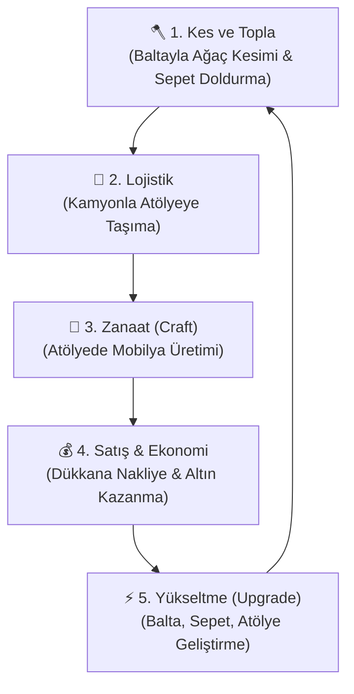

# 🪓 Forrest Game - Proje Yol Haritası & Mimari Dokümanı

Bu doküman, **Forrest Game** (İzometrik Idle/Tycoon Ormancılık & Mobilya Zanaatı) projesinin temel yapısını, oyun mekaniklerini, ekip rollerini, teknik mimarisini ve geleceğe yönelik yapılacak işleri detaylandırır. Projeye her başladığımızda bu dosya üzerinden güncel durumu takip edeceğiz.

---

## 📐 1. Proje Genel Bilgileri & Teknolojiler
* **Tür:** İzometrik, Idle/Tycoon, Hibrit Casual
* **Platform:** Mobil (iOS & Android hedefli) / PC
* **Oyun Motoru:** Unity 6 (6000.5.2f1)
* **Render Pipeline:** URP (Universal Render Pipeline) - İzometrik gölgelendirme ve mevsim geçiş efektleri için ideal.
* **Veritabanı & Backend:** Firebase (Auth, Firestore)
* **Versiyon Kontrol:** Git & GitHub (`develop` ana geliştirme dalı, `feature/` özellik dalları)

---

## 📂 2. Proje Klasör Yapısı (Folder Structure Guide)
Unity projemizin düzenli kalması ve varlıkların (asset) kaybolmaması için belirlenen klasör yapısı:

* 📁 `Assets/`
  * 📁 `Art/` — Mert (Modeller, Materyaller, Texture'lar)
    * 📁 `Characters/` — Karakter modelleri ve animasyonlar
    * 📁 `Environment/` — Ağaçlar, kayalar, binalar, yollar
    * 📁 `Vehicles/` — Kamyonlar, forkliftler
    * 📁 `UI/` — Butonlar, ikonlar, paneller
  * 📁 `Audio/` — Yasir (Ses Efektleri ve Müzikler)
    * 📁 `SFX/` — Balta vuruşları, motor sesleri, coin sesleri
    * 📁 `Music/` — Arka plan müzikleri, mevsimsel müzikler
  * 📁 `Prefabs/` — Efe & Mert (Hazır oyun objeleri)
    * 📁 `Trees/` — Çam, Meşe, Huş prefabları
    * 📁 `Furniture/` — Üretilen tabure, masa vb.
    * 📁 `VFX/` — Yaprak dökümü, kar, toz tanecikleri
  * 📁 `Scenes/` — Ortak (Oyun sahneleri)
  * 📁 `Scripts/` — Efe & Abdullah & Yasir (Kod yapısı)
    * 📁 `Core/` — Game Manager, Event Manager, Time Manager
    * 📁 `Gameplay/` — Player Controller, Tree, Axe, Sepet Logic
    * 📁 `Logistics/` — Truck Controller, Workshop (Atölye) Logic
    * 📁 `Backend/` — Firebase Manager, Save/Load System
    * 📁 `UI/` — UI Managers, Panel Controllers
    * 📁 `Data/` — ScriptableObjects (Ağaç verileri, yükseltme verileri)
  * 📁 `Settings/` — URP ayarları ve Input Action tanımları

---

## 🔄 3. Temel Oyun Döngüsü (Core Game Loop)
Oyunun bağımlılık yaratan çekirdek döngüsü 5 adımdan oluşur:

---

## 👥 4. Ekip Rolleri & Sorumluluk Dağılımı

### 💻 1. Yazılımcı - Gameplay Programmer (EFE)
* **Oyuncu Kontrolleri:** İzometrik hareket (NavMesh veya Direct Input), animasyonların tetiklenmesi.
* **Ağaç Kesme Mekaniği:** Ağaca yaklaşma, vuruş hasarı (Axe Damage), ağacın devrilme/kırılma fiziği ve odunların sırta uçması.
* **Envanter (Sepet):** Sırttaki sepetin görsel olarak dolması (üst üste dizilen odunlar).
* **Lojistik Tetikleyiciler:** Sepet dolunca kamyonete boşaltma alanı, kamyonetin atölyeye gidip gelme tetikleyicisi.
* **Üretim (Craft):** Atölye alanına odun teslimatı ve mobilya üretim animasyon süreçleri.

### ☁️ 2. Yazılımcı - Backend / UI / Firebase (ABDULLAH)
* **Firebase Entegrasyonu:** Guest Login (Misafir girişi), Email Login, Verilerin buluta otomatik ve manuel kaydedilmesi (Cloud Save/Sync).
* **Veri Modelleri (Save Data):** Altın miktarı, XP, Player Level, Balta/Sepet/Kamyon/Atölye seviyeleri, Açılan bölgeler, Aktif mevsim ve süre.
* **Yükseltme Matematiği Kodlaması:** Yasir'in hazırladığı formüllere göre seviye maliyeti hesaplama.
* **Arayüz (UI) Yönetimi:** Tüm menüler, upgrade paneli, XP barı, sepet doluluk göstergesi, atölye üretim sırası (queue) ve bildirim sistemleri.

### 🎨 3. Tasarımcı - Art & Environment Designer (MERT)
* **Modelleme & Animasyon:** Düşük poli (Low-Poly) izometrik tarzda karakter, araçlar (Kamyon, satış kamyonu) ve mobilyalar.
* **Çevre Tasarımı:** Orman alanları, bağ evi, fabrika, nehir, köprü ve sisli kilitli bölgeler.
* **Mevsimsel Görsel Varlıklar:** İlkbahar çiçekleri, yaz yeşilliği, sonbahar yaprakları, kış karları ve çıplak ağaç modelleri.
* **Parçacık Efektleri (VFX):** Balta vuruş kıymıkları, para saçılması, kar/yağmur havası.

### 📊 4. Game Designer, Audio & Project Manager (YASİR - Sen)
* **Oyun Dengesi (Balans):** Ağaçların canları, kesim süreleri, mobilyaların satış fiyatları ve kar marjları.
* **Yükseltme Formülleri:** Seviye atladıkça artan maliyetler ve kazanılan güç eğrileri.
* **Mevsim Balansı ve Etkileri:** Mevsim süreleri ve geçiş zamanlarının ayarlanması.
* **Ses Tasarımı (SFX & Music):** Balta sesleri, ağaç kırılmaları, buton, coin, kamyon sesleri ve ortam (ambiyans) müzikleri.
* **Proje Yönetimi (Trello):** Sprint planlama, görev takipleri ve bug (hata) listesi yönetimi.

---

## 📈 5. Derinlemesine Geliştirme (Upgrade) & Mevsim Sistemleri

### Yükseltme Parametreleri
1. **Balta (Axe):** Hasar (Sharpness) ve Kesim Hızı.
2. **Sepet (Basket):** Taşıma Kapasitesi (Örn: Seviye 1: 10 odun -> Seviye Max: 100 odun).
3. **Kamyonet (Truck):** Hız ve Maksimum Taşıma Kapasitesi.
4. **Atölye (Workshop):** Üretim hızı (Craft Time) ve Sıra Kuyruğu (Queue Size).
5. **Bölgeler (Regions):** Yeni ağaç türlerine (Çam -> Meşe -> Huş -> Abanoz) erişim sağlayan kilitli alanlar.

### 🍂 4 Mevsim Döngüsü (20 Dakikalık Döngüler)
Mevsimler sadece görsel değil, oynanışı da etkiler (15 dk Aktif Mevsim + 5 dk Yumuşak Geçiş):

| Mevsim | Görsel Etki | Oynanışa Etkisi (Buff / Debuff) |
| :--- | :--- | :--- |
| **🌸 İlkbahar** | Karlar erir, çiçekler açar, canlı yeşillik. | Ağaçların yeniden büyüme (respawn) hızı **%25 artar** (En iyi toplama mevsimi). |
| **☀️ Yaz** | Güneşli, parlak atmosfer, kısa kollu kıyafet. | Karakter hızı normal. Atölyedeki kurutulmuş odunlar sayesinde mobilya üretim hızı **%20 artar**. |
| **🍂 Sonbahar**| Turuncu yapraklar dökülür, yağmurlu/rüzgarlı. | Çamur nedeniyle kamyonet hızları **%15 düşer**. Dökülen yapraklardan **Nadir Mantar/Gömü** toplanabilir. |
| **❄️ Kış** | Kar kaplı zemin, çıplak ağaçlar, bacadan duman.| Ağaçlar donduğu için kesilmeleri **%10 zorlaşır**. Şömine yanı mobilyalar **%20 daha pahalıya** satılır. |

---

## 💡 6. Gözden Kaçabilecek Noktalar & Uzman Tavsiyeleri (Game Dev Gaps)
Acemi olduğun için şu 5 kritik noktayı tasarımımıza şimdiden eklemeliyiz:

1. **Çevrimdışı İlerleme (Offline Progress - Idle Earnings):**
   * *Problem:* Oyuncu oyunda yokken atölye durursa "Idle" hissi kaybolur.
   * *Çözüm:* Oyuncu oyunu açtığında geçen süreyi hesaplayıp (maksimum 8-12 saat ile sınırlı) çevrimdışı kazanılan parayı ve XP'yi bir pop-up ekranında sunmalıyız.
2. **Otomasyon ve İşçi Kiralama (Automation / Workers):**
   * *Problem:* Sadece oyuncunun ağaç kesmesi bir süre sonra sıkıcı "Grind" hissi yaratır.
   * *Çözüm:* Kazanılan paralarla ormana otomatik odun kesen yardımcı işçiler (Lumberjacks) ve atölyeye odun taşıyan taşıyıcılar kiralayabilmeliyiz.
3. **Mevsim Geçişleri Şablonu (Shader Blending):**
   * *Problem:* Mevsim değiştiğinde ağaçların üstündeki karın veya yerdeki çim renginin aniden değişmesi görsel kaliteyi düşürür.
   * *Çözüm:* Mert'in tasarlayacağı zemin ve ağaç materyallerinde bir "SnowAmount" veya "ColorLerp" parametresi olmalı. Yazılımcılar bunu kodla yavaşça sıfırdan bire çekerek 5 dakikalık geçişte yumuşak bir geçiş sağlamalı.
4. **Firebase Veri Güvenliği (Security Rules):**
   * *Problem:* Oyuncuların telefon saatini ileri alarak veya Firebase isteklerini taklit ederek sınırsız para kazanması.
   * *Çözüm:* Sunucu saati (Firebase Server Timestamp) kontrolü ve basit bir veri doğrulama kuralı eklemeliyiz.
5. **Nesne Havuzu (Object Pooling):**
   * *Problem:* Balta vurunca çıkan talaş partiküllerinin, yere düşen odunların sürekli `Instantiate` ve `Destroy` edilmesi mobil cihazlarda ani kasmalar (Lag Spikes) yaratır.
   * *Çözüm:* Efe'nin kodlamada tüm odunlar, talaş efektleri ve UI coin efektleri için Nesne Havuzu (Object Pool) kullanması şarttır.

---

## 📝 7. Yol Haritası (Milestones)

### 🟢 Sprint 1: Temel Mekanikler & Alt Yapı (Mevcut Durum)
* [x] Proje klasör yapısının oluşturulması (`Assets/Audio/SFX`, `Assets/Prefabs` vb.)
* [x] GitHub entegrasyonu ve güvenli branch yapısının kurulması (`feature/idle-wood-base`)
* [ ] `PROJECT_GUIDE.md` dosyasının projeye dahil edilmesi (Tamamlanıyor)

### 🟡 Sprint 2: Temel Oynanış Döngüsü (Efe & Mert)
* [ ] Karakterin izometrik hareketi ve temel animasyonları.
* [ ] Ağaç kesme tetikleyicisi ve odun toplama mekaniği.
* [ ] Sepet doluluk görselleştirmesi.

### 🟡 Sprint 3: Ekonomi, Veri ve UI (Abdullah & Yasir)
* [ ] Firebase veri tabanı kurulumu ve save/load yapısı.
* [ ] Temel UI panellerinin tasarlanması (Para, XP barı, Seviyeler).
* [ ] Balta ve Sepet yükseltme sisteminin kodlanması.

---

*Bu doküman projemiz geliştikçe güncellenecektir. Eklemek istediğin veya değiştirmek istediğin bir yer var mı kral?*
